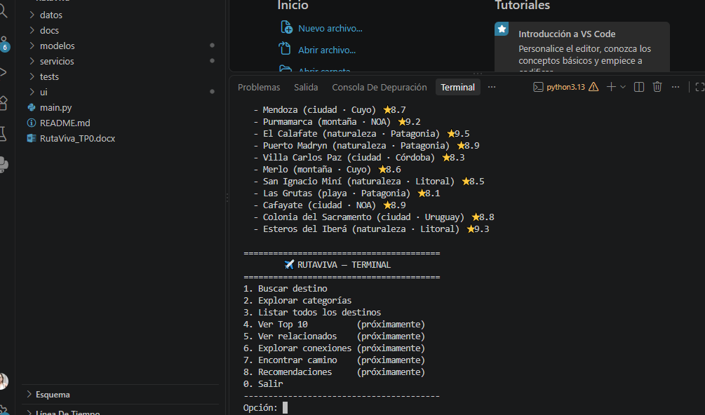

# RutaViva ✈️

Sistema de recomendación de destinos de viaje — TP Integrador de Estructuras de Datos.

**Estado actual:** TP8 — Recorridos BFS y DFS  
**Versión:** 6

RutaViva es una aplicación de terminal que permite consultar destinos turísticos, explorar categorías, obtener los destinos mejor valorados y descubrir relaciones entre destinos mediante un grafo.

## Funcionalidades

La aplicación ofrece las siguientes opciones desde el menú de terminal:

1. **Buscar destino:** busca un destino por nombre mediante un árbol binario de búsqueda (BST).
2. **Explorar categorías:** permite recorrer la jerarquía de categorías mediante un árbol general.
3. **Listar todos los destinos:** muestra los destinos cargados en el catálogo.
4. **Ver Top 10:** obtiene los destinos mejor puntuados utilizando una heap binaria máxima.
5. **Ver relacionados:** muestra destinos conectados y los motivos de su relación.
6. **Explorar conexiones:** permite consultar los vecinos de un destino en el grafo.
7. **Encontrar camino:** funcionalidad pendiente de implementación.
8. **Recomendaciones (BFS):** recorre el grafo por niveles y presenta primero los destinos alcanzables con menor cantidad de conexiones.
9. **Explorar destinos en profundidad (DFS):** recorre en profundidad la red de destinos relacionados desde un destino inicial.

## Estructuras de datos y algoritmos

- **Lista de objetos `Destino`:** almacena los destinos cargados desde `datos/destinos.json`.
- **Árbol binario de búsqueda (BST):** organiza los destinos por nombre y permite realizar búsquedas.
- **Árbol AVL:** implementación de un árbol binario de búsqueda balanceado. En la versión actual está implementado de manera independiente y no está integrado al menú principal.
- **Árbol general:** representa la jerarquía de categorías y subcategorías.
- **Heap binaria máxima:** permite obtener los destinos con mayor rating.
- **Grafo no dirigido con listas de adyacencia:** cada vértice representa un destino y las aristas representan relaciones entre destinos que comparten región o categoría.
- **BFS (búsqueda en anchura):** se utiliza para recomendar destinos por cercanía en cantidad de aristas. La implementación utiliza una cola `deque`.
- **DFS (búsqueda en profundidad):** se utiliza para explorar los destinos alcanzables siguiendo las conexiones del grafo.

En el grafo actual, las conexiones no tienen pesos: no representan kilómetros, duración ni costo económico del viaje.

## Organización del proyecto

- `datos/`: contiene los datos de los destinos en formato JSON.
- `modelos/`: contiene las clases que representan los objetos del dominio.
- `servicios/`: contiene el catálogo, las estructuras de datos y las consultas.
- `ui/`: contiene la interfaz de terminal.
- `tests/`: contiene las pruebas automatizadas.
- `docs/`: contiene la documentación del proyecto y de las entregas.

## Documentación

- [Casos de uso](docs/02-casos-de-uso.md)
- [Diagrama de clases](docs/03_diagrama_clases.md)
- [Diagrama de conexión entre estructuras de datos](docs/04-diagrama-datos.md)
- [Documentación TP8: recorridos BFS y DFS](docs/tp8-recorridos.md)

## Requisitos

- Python 3.10 o superior.
- No requiere dependencias externas.

## Ejecución

Desde la carpeta principal del proyecto, ejecutar:

```bash
python main.py
```

## Pruebas automatizadas

Para ejecutar todas las pruebas:

```bash
python -m unittest discover -s tests -v
```

Las pruebas verifican el comportamiento del catálogo, las estructuras de datos y las consultas implementadas, incluidos los recorridos del grafo.

## Demostración

La siguiente captura corresponde a una demostración de la aplicación en terminal:


