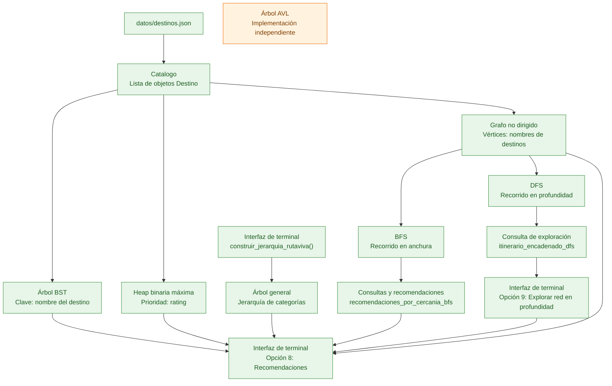

from pathlib import Path

content = r'''# TP7.5 / TP8 — Diagrama de conexión entre estructuras de datos

## 1. Introducción

Este documento muestra cómo se organizan y se relacionan las estructuras de datos utilizadas en RutaViva, incluyendo los recorridos BFS y DFS incorporados en el TP8.

El sistema carga los destinos turísticos desde un archivo JSON y crea objetos de la clase `Destino`. Estos objetos se almacenan en el catálogo y sirven como información de base para las distintas funcionalidades.

A partir del catálogo, RutaViva utiliza un árbol binario de búsqueda (BST), una heap binaria y un grafo. También cuenta con un árbol general para organizar categorías. El árbol AVL está implementado y probado de manera independiente, pero en la versión actual no está integrado al catálogo ni al menú.

En el TP8 se completó la integración de los dos recorridos del grafo: BFS se utiliza para mostrar recomendaciones por cercanía y DFS para explorar la red de destinos en profundidad desde la terminal.

## 2. Diagrama general de conexión

El siguiente diagrama representa el flujo de los datos y las estructuras según la implementación actual del proyecto.

**Aclaración:** las flechas representan relaciones de uso y construcción, no significan que todas las estructuras se creen al mismo tiempo. Por ejemplo, la heap se construye cuando se solicita el Top 10 y el grafo se construye la primera vez que se accede a él.

## 3. Cómo se conectan los datos y las estructuras

### 3.1. Archivo JSON y objetos Destino

**Archivos:** `datos/destinos.json` y `modelos/destino.py`.

El archivo JSON contiene los datos de los destinos turísticos. El método `cargar_desde_json()` de `Catalogo`, definido en `servicios/catalogo.py`, lee esos datos y crea un objeto `Destino` por cada registro.

Cada objeto contiene nombre, categoría, región, rating y descripción. Los objetos creados se guardan en la lista interna `_destinos` del catálogo.

### 3.2. Catálogo y árbol BST

**Archivos:** `servicios/catalogo.py` y `servicios/arbol_binario.py`.

Después de cargar el JSON, `main.py` llama a `catalogo.construir_arbol()`.

El método `construir_arbol()` inserta en el BST cada objeto `Destino`, usando su nombre en minúsculas como clave y el propio objeto como elemento.

La opción 1 del menú, «Buscar destino», utiliza `buscar_en_arbol()` para localizar un destino por nombre.

### 3.3. Catálogo y heap binaria

**Archivos:** `servicios/catalogo.py` y `servicios/heap_binaria.py`.

La heap binaria es una Max-Heap: el elemento con mayor prioridad queda en la raíz. En RutaViva, la prioridad corresponde al rating del destino.

Cuando se solicita la opción 4, «Ver Top 10», la interfaz llama al método `top_n()` del catálogo. Este método arma una heap con los destinos y sus ratings, y extrae los de mayor prioridad hasta obtener la cantidad solicitada.

La heap se construye para realizar esa consulta; no se mantiene como una estructura permanente del catálogo.

### 3.4. Catálogo y grafo

**Archivos:** `servicios/catalogo.py` y `servicios/grafo.py`.

El grafo representa las relaciones entre destinos turísticos:

- Cada vértice se identifica con el nombre de un destino.
- Dos destinos se conectan si comparten la misma región o la misma categoría.
- Es un grafo no dirigido y se representa mediante listas de adyacencia.

El método `construir_grafo()` del catálogo agrega los vértices y compara los pares de destinos para crear las conexiones correspondientes.

La propiedad `grafo` del catálogo construye el grafo cuando se accede a él por primera vez y todavía no tiene vértices.

La interfaz utiliza el grafo en las opciones 5 («Ver relacionados») y 6 («Explorar conexiones»). También lo utiliza en las opciones 8 y 9 para ejecutar los recorridos BFS y DFS, respectivamente.

### 3.5. Grafo y BFS

**Archivos:** `servicios/grafo.py`, `servicios/consultas_grafo.py` y `ui/terminal.py`.

BFS (*Breadth-First Search* o búsqueda en anchura) recorre primero los vecinos directos del destino inicial y luego continúa con los destinos de los siguientes niveles. Utiliza una cola FIFO (primero en entrar, primero en salir) y un conjunto de visitados para evitar procesar un vértice más de una vez.

La implementación utiliza `deque` para extraer elementos del comienzo de la cola eficientemente. Con listas de adyacencia y un conjunto de visitados, el recorrido tiene una complejidad temporal O(V + E), donde V es la cantidad de vértices y E la cantidad de aristas.

La función `recomendaciones_por_cercania_bfs()` de `consultas_grafo.py` utiliza el recorrido BFS, excluye el destino de origen y devuelve los demás destinos en el orden de visita.

La opción 8 del menú utiliza esta función para mostrar recomendaciones ordenadas por cercanía dentro del grafo. En este contexto, «cercanía» significa cantidad de aristas o conexiones, no distancia geográfica en kilómetros ni tiempo de viaje.

### 3.6. Grafo y DFS

**Archivos:** `servicios/grafo.py`, `servicios/consultas_grafo.py` y `ui/terminal.py`.

DFS (*Depth-First Search* o búsqueda en profundidad) explora un camino todo lo posible antes de retroceder y continuar con otros vecinos. La implementación utiliza una pila y un conjunto de visitados para evitar repetir vértices.

Con listas de adyacencia y un conjunto de visitados, DFS tiene una complejidad temporal O(V + E), donde V es la cantidad de vértices y E la cantidad de aristas.

La función `itinerario_encadenado_dfs()` de `consultas_grafo.py` utiliza el método `dfs()` de la clase `Grafo` para obtener un recorrido desde un destino inicial.

La opción 9 del menú, «Explorar destinos en profundidad (DFS)», permite ingresar un destino y mostrar los destinos alcanzables en el orden en que DFS los visita. Esta función sirve para explorar la red de conexiones; no ordena los destinos por calidad, distancia geográfica ni tiempo de viaje.

### 3.7. Diferencia de uso entre BFS y DFS

Los dos algoritmos recorren el grafo y evitan visitar repetidamente los mismos vértices, pero siguen estrategias diferentes:

- **BFS:** explora por niveles. Es adecuado para encontrar destinos con menor cantidad de conexiones desde el origen y por eso se utiliza en las recomendaciones de la opción 8.
- **DFS:** profundiza por una conexión antes de retroceder. Es adecuado para recorrer y explorar los destinos alcanzables desde un origen y por eso se utiliza en la opción 9.

Ambos tienen complejidad temporal O(V + E) con la representación por listas de adyacencia. La diferencia principal está en el orden de exploración y en el tipo de consulta que permiten resolver.

### 3.8. Árbol general y categorías

**Archivos:** `servicios/arbol_general.py` y `ui/terminal.py`.

El árbol general representa una jerarquía de categorías de RutaViva. Su raíz se llama «RutaViva» y contiene categorías como Naturaleza, Montaña, Playa y Ciudad, con sus respectivas subcategorías.

La función `construir_jerarquia_rutaviva()` de `ui/terminal.py` crea esta estructura. La opción 2, «Explorar categorías», permite recorrerla desde la interfaz.

En la implementación actual, esta jerarquía se construye desde la interfaz y no se genera a partir del archivo JSON ni de la lista de destinos del catálogo.

### 3.9. Árbol AVL

**Archivo:** `servicios/arbol_avl.py`.

El proyecto incluye una implementación de árbol AVL. Es un árbol binario de búsqueda que actualiza las alturas y utiliza rotaciones para mantener el equilibrio después de insertar elementos.

En la versión actual, el AVL está implementado y cuenta con pruebas, pero funciona de manera independiente: no se construye desde `Catalogo`, no se utiliza en `main.py` y no tiene una opción asociada en el menú.

Por eso, se muestra separado en el diagrama y no como parte del flujo principal de datos.

## 4. Relación con las opciones del menú

| Opción | Funcionalidad | Estructura o algoritmo utilizado |
|---|---|---|
| 1 | Buscar destino | Árbol BST |
| 2 | Explorar categorías | Árbol general |
| 3 | Listar todos los destinos | Lista del catálogo |
| 4 | Ver Top 10 | Heap binaria máxima |
| 5 | Ver relacionados | Grafo |
| 6 | Explorar conexiones | Grafo y listas de adyacencia |
| 7 | Encontrar camino | Próximamente; no implementado |
| 8 | Recomendaciones | Grafo y BFS |
| 9 | Explorar destinos en profundidad | Grafo y DFS |
| — | Búsqueda con AVL | Implementado de manera independiente, sin opción en el menú |

## 5. Conclusión

Las estructuras de datos de RutaViva cumplen funciones diferentes y permiten resolver distintas necesidades del sistema.

El catálogo conserva los objetos `Destino`. El BST permite buscarlos por nombre, la heap binaria permite obtener los mejor valorados, el grafo representa las relaciones entre destinos, BFS permite generar recomendaciones por cercanía en cantidad de conexiones y DFS permite explorar en profundidad la red de destinos. El árbol general organiza las categorías.

Además, el proyecto incluye un árbol AVL implementado y probado de manera independiente, que todavía no está conectado al flujo principal del menú.

Este diagrama permite comprender cómo se organiza la información, qué estructura utiliza cada funcionalidad y cómo se relacionan las partes principales de RutaViva en su estado actual, incluyendo las incorporaciones del TP8.
'''

out = Path("/mnt/data/04-diagrama-datos-actualizado.md")
out.write_text(content, encoding="utf-8")
print(f"Archivo creado: {out}")
