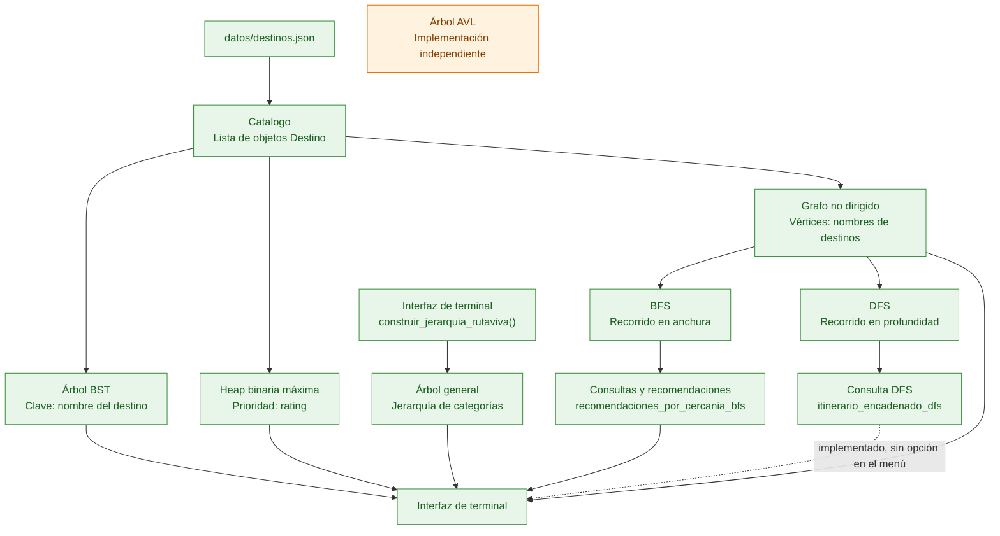

# TP7.5 — Diagrama de conexión entre estructuras de datos

## 1. Introducción

Este documento muestra cómo se organizan y se relacionan las estructuras de datos utilizadas en RutaViva.

El sistema carga los destinos turísticos desde un archivo JSON y crea objetos de la clase `Destino`. Estos objetos se almacenan en el catálogo y sirven como información de base para las distintas funcionalidades.

A partir del catálogo, RutaViva utiliza un árbol binario de búsqueda (BST), una heap binaria y un grafo. También cuenta con un árbol general para organizar categorías. El árbol AVL está implementado y probado de manera independiente, pero en la versión actual no está integrado al catálogo ni al menú.

## 2. Diagrama general de conexión

El siguiente diagrama representa el flujo de los datos y las estructuras según la implementación actual del proyecto.

**Aclaración:** las flechas representan relaciones de uso y construcción, no significan que todas las estructuras se creen al mismo tiempo. Por ejemplo, la heap se construye cuando se solicita el Top 10 y el grafo se construye la primera vez que se accede a él.

## 3. Cómo se conectan los datos y las estructuras

### 3.1. Archivo JSON y objetos Destino

**Archivos:** `datos/destinos.json` y `modelos/destino.py`.

El archivo JSON contiene los datos de los destinos turísticos. El método `cargar_desde_json()` de `Catalogo`, definido en `servicios/catalogo.py`, lee esos datos y crea un objeto `Destino` por cada registro.

Cada objeto contiene nombre, categoría, región, rating y descripción. Los objetos creados se guardan en la lista interna `_destinos` del catálogo.

### 3.2. Catálogo y árbol BST

**Archivos:** `servicios/catalogo.py` y `servicios/arbol_binario.py`.

Después de cargar el JSON, `main.py` llama a `catalogo.construir_arbol()`.

El método `construir_arbol()` inserta en el BST cada objeto `Destino`, usando su nombre en minúsculas como clave y el propio objeto como elemento.

La opción 1 del menú, «Buscar destino», utiliza `buscar_en_arbol()` para localizar un destino por nombre.

### 3.3. Catálogo y heap binaria

**Archivos:** `servicios/catalogo.py` y `servicios/heap_binaria.py`.

La heap binaria es una Max-Heap: el elemento con mayor prioridad queda en la raíz. En RutaViva, la prioridad corresponde al rating del destino.

Cuando se solicita la opción 4, «Ver Top 10», la interfaz llama al método `top_n()` del catálogo. Este método arma una heap con los destinos y sus ratings, y extrae los de mayor prioridad hasta obtener la cantidad solicitada.

La heap se construye para realizar esa consulta; no se mantiene como una estructura permanente del catálogo.

### 3.4. Catálogo y grafo

**Archivos:** `servicios/catalogo.py` y `servicios/grafo.py`.

El grafo representa las relaciones entre destinos turísticos:

- Cada vértice se identifica con el nombre de un destino.
- Dos destinos se conectan si comparten la misma región o la misma categoría.
- Es un grafo no dirigido y se representa mediante listas de adyacencia.

El método `construir_grafo()` del catálogo agrega los vértices y compara los pares de destinos para crear las conexiones correspondientes.

La propiedad `grafo` del catálogo construye el grafo cuando se accede a él por primera vez y todavía no tiene vértices.

La interfaz utiliza el grafo en las opciones 5 («Ver relacionados») y 6 («Explorar conexiones»). La opción 8 también lo utiliza para generar recomendaciones mediante BFS.

### 3.5. Grafo y BFS

**Archivos:** `servicios/grafo.py`, `servicios/consultas_grafo.py` y `ui/terminal.py`.

BFS (*Breadth-First Search* o búsqueda en anchura) recorre primero los vecinos directos del destino inicial y luego continúa con los destinos de los siguientes niveles.

La función `recomendaciones_por_cercania_bfs()` de `consultas_grafo.py` utiliza el recorrido BFS, excluye el destino de origen y devuelve los demás destinos en el orden de visita.

La opción 8 del menú utiliza esta función para mostrar recomendaciones ordenadas por cercanía dentro del grafo.

### 3.6. Grafo y DFS

**Archivos:** `servicios/grafo.py` y `servicios/consultas_grafo.py`.

DFS (*Depth-First Search* o búsqueda en profundidad) explora un camino todo lo posible antes de retroceder y continuar con otros vecinos.

El método `dfs()` está implementado en la clase `Grafo`. La función `itinerario_encadenado_dfs()` de `consultas_grafo.py` lo utiliza para obtener un recorrido desde un destino inicial.

En la versión actual, DFS está implementado y cuenta con una función de consulta, pero no está conectado a una opción del menú de terminal.

### 3.7. Árbol general y categorías

**Archivos:** `servicios/arbol_general.py` y `ui/terminal.py`.

El árbol general representa una jerarquía de categorías de RutaViva. Su raíz se llama «RutaViva» y contiene categorías como Naturaleza, Montaña, Playa y Ciudad, con sus respectivas subcategorías.

La función `construir_jerarquia_rutaviva()` de `ui/terminal.py` crea esta estructura. La opción 2, «Explorar categorías», permite recorrerla desde la interfaz.

En la implementación actual, esta jerarquía se construye desde la interfaz y no se genera a partir del archivo JSON ni de la lista de destinos del catálogo.

### 3.8. Árbol AVL

**Archivo:** `servicios/arbol_avl.py`.

El proyecto incluye una implementación de árbol AVL. Es un árbol binario de búsqueda que actualiza las alturas y utiliza rotaciones para mantener el equilibrio después de insertar elementos.

En la versión actual, el AVL está implementado y cuenta con pruebas, pero funciona de manera independiente: no se construye desde `Catalogo`, no se utiliza en `main.py` y no tiene una opción asociada en el menú.

Por eso, se muestra separado en el diagrama y no como parte del flujo principal de datos.

## 4. Relación con las opciones del menú

| Opción | Funcionalidad | Estructura o algoritmo utilizado |
|---|---|---|
| 1 | Buscar destino | Árbol BST |
| 2 | Explorar categorías | Árbol general |
| 3 | Listar todos los destinos | Lista del catálogo |
| 4 | Ver Top 10 | Heap binaria máxima |
| 5 | Ver relacionados | Grafo |
| 6 | Explorar conexiones | Grafo y listas de adyacencia |
| 7 | Encontrar camino | Próximamente; no implementado |
| 8 | Recomendaciones | Grafo y BFS |
| — | Itinerario DFS | Implementado en servicios, sin opción en el menú |
| — | Búsqueda con AVL | Implementado de manera independiente, sin opción en el menú |

## 5. Conclusión

Las estructuras de datos de RutaViva cumplen funciones diferentes y permiten resolver distintas necesidades del sistema.

El catálogo conserva los objetos `Destino`. El BST permite buscarlos por nombre, la heap binaria permite obtener los mejor valorados, el grafo representa las relaciones entre destinos y BFS permite generar recomendaciones por cercanía. El árbol general organiza las categorías.

Además, el proyecto incluye DFS y AVL implementados, aunque en la versión actual no están conectados a opciones del menú.

Este diagrama permite comprender cómo se organiza la información, qué estructura utiliza cada funcionalidad y cómo se relacionan las partes principales de RutaViva.
